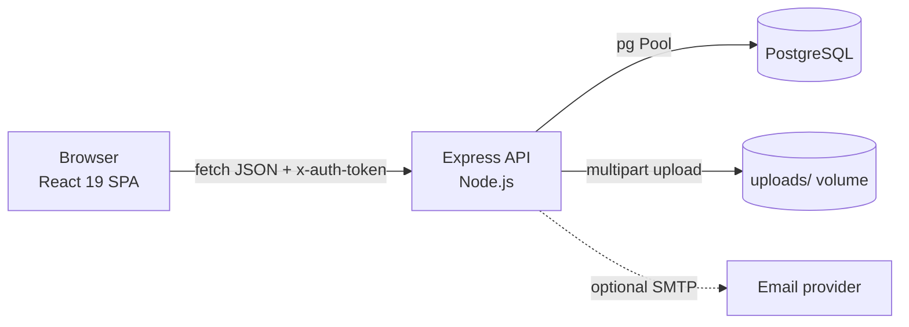
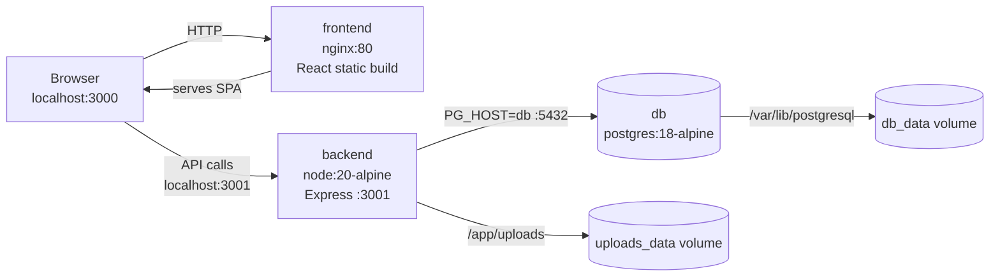

# Service Connect

Service Connect is a full-stack local services marketplace. Customers find verified
professionals by service category and distance, request a booking, accept a quoted
price, chat with the provider, pay from an in-app wallet and leave a review. Providers
manage requests, set prices, track earnings and request withdrawals. Administrators
moderate providers, approve wallet deposits/withdrawals and read contact messages.

## 1. Project overview

- **Problem it solves:** hiring a local professional (electrician, plumber, painter,
  etc.) is opaque — no price agreement before work starts, no verified reviews, no
  traceable payment. Service Connect makes the whole transaction explicit.
- **Main features**
  - Email/OTP registration and login for customers and providers (JWT auth).
  - Service catalogue, provider search filtered by distance and service radius.
  - Two-step booking: provider quotes a price, customer explicitly accepts it.
  - Per-booking chat with image/PDF attachments and unread indicators.
  - Wallet with admin-verified UPI deposits, provider withdrawals and payments.
  - Reviews that recalculate provider ratings.
  - Admin console: metrics, provider verification, wallet approvals, users, bookings,
    contact messages.
- **Target users:** households looking for vetted local professionals; independent
  tradespeople; platform operators.

## 2. Technology stack

| Layer | Technology |
|---|---|
| Frontend | React 19 (Create React App / react-scripts 5), Tailwind CSS via CDN, plain `fetch` |
| Backend | Node.js 20+ (tested on 24), Express 5, `pg`, `bcrypt`, `jsonwebtoken`, `multer`, `nodemailer` |
| Database | PostgreSQL 18 (14+ works; plain SQL schema, no ORM) |
| Email | Nodemailer over SMTP (optional in development) |
| Infrastructure | Docker + Docker Compose (PostgreSQL, API, nginx-served SPA) |
| Tooling | npm, Node's built-in test runner, Jest via react-scripts |

No AI/LLM integration exists in this project.

## 3. Architecture

```
Browser (React SPA)
   │  fetch + x-auth-token (JWT)
   ▼
Express API  ──► PostgreSQL (pg Pool)
   │
   ├──► local disk uploads/ (profile photos, deposit proofs, chat files)
   └──► SMTP (verification / notification email, optional)
```

Request lifecycle:

1. The SPA calls the API at `REACT_APP_API_BASE_URL` with a JWT in the `x-auth-token` header.
2. CORS allows only the configured origins (`CORS_ORIGIN`).
3. `requestLogger` assigns a request id and logs method/path/status/duration as JSON.
4. Public routes are unauthenticated; protected routes verify the JWT (`middleware/auth.js`)
   and then check the role inside the handler (customer / provider / admin).
5. Handlers use parameterized SQL through a shared `pg` pool, often inside transactions
   (`BEGIN`/`COMMIT`/`ROLLBACK`) for money movements.
6. Uploaded files are written to `uploads/` and served from `/uploads/*`; the URL is built
   from `PUBLIC_BASE_URL` so it stays browser-reachable inside Docker.
7. Any thrown error reaches the centralized error handler, which returns JSON and logs.



## 4. Project structure

```
.
├── docker-compose.yml          # db + backend + frontend stack
├── .env.example                # compose environment template
├── data_base.sql               # legacy PostgreSQL 18 custom-format dump (optional)
├── docs/
│   ├── PROJECT_AUDIT.md        # issues found, severity, root cause, status
│   └── FINAL_AUDIT_REPORT.md   # verification results and remaining work
├── server/                     # Express API
│   ├── index.js                # app wiring: CORS, logging, routes, /health, errors
│   ├── middleware/auth.js      # JWT verification (x-auth-token)
│   ├── db/schema.sql           # idempotent schema (source of truth)
│   ├── db/seed.sql             # service catalogue seed
│   ├── scripts/migrate.js      # applies schema + seed
│   ├── scripts/wait-for-db.js  # readiness gate used by Docker entrypoint
│   ├── docker-entrypoint.sh    # wait → migrate → start
│   ├── src/config/             # db, upload (multer), nodemailer
│   ├── src/middleware/         # rate limiter
│   ├── src/routes/             # public, auth, user, booking, customer, provider, payment, admin
│   ├── src/utils/              # helpers (distance, OTP, URLs), structured logger
│   ├── tests/                  # Node test runner unit tests
│   └── uploads/                # runtime user files (gitignored)
└── frontend/                   # React SPA
    ├── Dockerfile              # build → nginx
    ├── nginx.conf              # SPA fallback + /healthz
    ├── public/                 # static assets (images, QR code, index.html)
    └── src/
        ├── App.js              # page router (state based)
        ├── context/AuthContext.js
        ├── components/         # shared UI, auth forms, modals
        └── pages/              # home, services, dashboards, utils/helpers.js
```

## 5. Prerequisites

- Git
- Node.js **20 or newer** and npm 10+ (`node -v`)
- Docker Desktop with Docker Compose v2 (`docker compose version`) — for the Docker path
- PostgreSQL 14+ running locally — only for the non-Docker path
  (this project was verified against PostgreSQL 18)
- Ports **3000** (frontend), **3001** (API) and **5433** (Docker database) free

## 6. Environment setup

Clone and install:

```powershell
git clone <repository-url>
cd service-connect-website
```

### Backend environment

```powershell
Copy-Item server\.env.example server\.env
```

Generate a JWT secret and put it in `server\.env`:

```powershell
node -e "console.log(require('crypto').randomBytes(48).toString('hex'))"
```

| Variable | Purpose |
|---|---|
| `PORT`, `HOST` | API port (default 3001) and bind address |
| `JWT_SECRET` | **Required.** Signing key; the API exits if missing |
| `ADMIN_EMAIL` | Existing account email that is escalated to admin at login |
| `CORS_ORIGIN` | Comma-separated browser origins allowed to call the API |
| `PUBLIC_BASE_URL` | Public origin used in upload URLs (e.g. `http://localhost:3001`) |
| `PG_HOST`, `PG_PORT`, ``PG_DATABASE`, `PG_USER`, `PG_PASSWORD` | PostgreSQL connection |
| `DATABASE_URL` | Alternative single connection string |
| `EMAIL_USER`, `EMAIL_PASS`, `EMAIL_SERVICE` | SMTP credentials (optional) |
| `UPLOAD_DIR` | Upload directory (defaults to `server/uploads`) |
| `SEED` | `false` skips the service seed during migration |
| `LOG_LEVEL` | `error` \| `warn` \| `info` \| `debug` |

### Frontend environment

```powershell
Copy-Item frontend\.env.example frontend\.env
```

`REACT_APP_API_BASE_URL` is compiled into the bundle — restart the dev server (or rebuild
the Docker image) after changing it.

Never commit `.env` files. Only `.env.example` templates belong in git.

## 7. Run locally (without Docker)

### 7.1 Database

Windows (PostgreSQL installed as a service):

```powershell
# create an empty database (password prompt)
& "C:\Program Files\PostgreSQL\18\bin\psql.exe" -U postgres -c "CREATE DATABASE service_connect;"
```

Linux / macOS:

```bash
sudo -u postgres createdb service_connect
```

Match `PG_*` in `server\.env` to your installation (user `postgres`, your password,
port 5432).

### 7.2 Apply schema and seed

```powershell
cd server
npm install
npm run migrate
```

`npm run migrate` applies `db/schema.sql` (idempotent) and `db/seed.sql` (12 service
categories) and prints the tables that exist. Re-running it is safe.

> The committed `data_base.sql` is a PostgreSQL **custom-format** dump, not plain SQL.
> It is not used by the app. If you want the historical sample data instead, restore it
> with a matching client:
> `& "C:\Program Files\PostgreSQL\18\bin\pg_restore.exe" -U postgres -d service_connect --no-owner --no-privileges data_base.sql`

### 7.3 Start the backend

```powershell
cd server
npm start          # production-style: node index.js
# or
npm run dev        # node --watch index.js
```

Verify:

```powershell
curl http://localhost:3001/health
curl http://localhost:3001/api/v1/services
```

`/health` returns `{"status":"ok",...,"database":{"status":"up"}}`. Backend logs are
JSON lines including one `http_request` entry per request.

### 7.4 Start the frontend

```powershell
cd frontend
npm install
npm start
```

Open <http://localhost:3000>. The SPA reads `REACT_APP_API_BASE_URL` from
`frontend\.env`; the default is `http://localhost:3001/api/v1`.

### 7.5 Create an administrator

Registration only creates customers and providers. Any account whose email equals
`ADMIN_EMAIL` is escalated to `admin` **at login**:

1. Set `ADMIN_EMAIL=you@example.com` in `server\.env` and restart the API.
2. Register that email as a customer, verify the OTP, then log in — the response and
   subsequent requests have role `admin`.

### 7.6 Email / OTP in development

If `EMAIL_USER`/`EMAIL_PASS` are empty (or SMTP rejects the message) and
`NODE_ENV` is not `production`, registration and password-reset responses include a
`dev_otp` field, and the API stays fully usable without a mail server. Configure SMTP
for real deployments — the fallback is disabled in production.

## 8. Run with Docker Compose

```powershell
Copy-Item .env.example .env
# edit .env: set POSTGRES_PASSWORD and JWT_SECRET
docker compose up --build
```

What happens automatically:

1. `db` starts PostgreSQL 18 with a persistent volume and a `pg_isready` healthcheck.
2. `backend` waits for the database to accept connections (`scripts/wait-for-db.js`).
3. The entrypoint applies `db/schema.sql` and `db/seed.sql` (`scripts/migrate.js`).
4. Only then does the API start and begin serving on port 3001.
5. `frontend` builds the React app and starts nginx; it waits for the backend to be
   healthy before starting.

Open <http://localhost:3000>. API: <http://localhost:3001/api/v1>.

### Common commands

| Command | What it does |
|---|---|
| `docker compose up --build` | Build images and run in the foreground |
| `docker compose up --build -d` | Same, detached |
| `docker compose logs -f` | Follow all logs |
| `docker compose logs -f backend` | Follow API logs |
| `docker compose logs -f frontend` | Follow nginx logs |
| `docker compose logs -f db` | Follow PostgreSQL logs |
| `docker compose ps` | Show container and health status |
| `docker compose down` | Stop and remove containers (database data is kept) |
| `docker compose down -v` | Stop and delete volumes — **this destroys all database and upload data** |
| `docker compose up --build` | Rebuild after code or env changes |

Expected result: `db (healthy)`, `backend (healthy)`, `frontend (healthy)`.
Database data lives in the `db_data` volume, uploads in `uploads_data`.

Ports can be changed in `.env` (`FRONTEND_PORT`, `BACKEND_PORT`, `DB_PORT`). If you change
`BACKEND_PORT`, also update `PUBLIC_BASE_URL`, `CORS_ORIGIN` and `REACT_APP_API_BASE_URL`
and rebuild the frontend, because those URLs are compiled into the bundle.

## 9. Docker architecture



- **Services:** `db`, `backend`, `frontend` on the bridge network `service-connect-net`.
- **Internal DNS:** the API connects to `db:5432`; `localhost` inside a container is the
  container itself, never the host.
- **Browser-facing URLs:** the SPA uses `http://localhost:3001/api/v1` (the published API
  port) — not `http://backend:3001`, which only resolves inside Docker.
- **Port mapping:** `3000:80` (frontend), `3001:3001` (API), `5433:5432` (database; 5433
  avoids a clash with a locally installed PostgreSQL).
- **Environment:** injected from `.env` at run time, except `REACT_APP_API_BASE_URL`, which
  is a build argument baked into the bundle.
- **Healthchecks:** `pg_isready` for the database, `GET /health` for the API, `GET /healthz`
  for nginx.
- **Startup order:** `db healthy → backend healthy → frontend`.
- **Volumes:** `db_data` (database files) and `uploads_data` (user uploads) survive
  `docker compose down` and container restarts.

## 10. API documentation

Base URL: `http://localhost:3001/api/v1` (Docker and local).
Authentication: send the JWT from `POST /auth/login` in the **`x-auth-token`** header.

### Public

| Method | Path | Description |
|---|---|---|
| GET | `/` | API status text |
| GET | `/services` | List service categories |
| GET | `/providers?service_id=&lat=&lon=&sort_by=top_rated` | Verified providers; distance-filtered when lat/lon given |
| POST | `/contact-us` | `{ name, email, problem_description }` |

### Auth

| Method | Path | Body |
|---|---|---|
| POST | `/auth/register` | `{ email, password, role: "customer"\|"provider" }` → sends OTP |
| POST | `/auth/verify-otp` | `{ email, otp }` |
| POST | `/auth/login` | `{ email, password }` → `{ token, role, user_id }` |
| POST | `/auth/forgot-password` | `{ email }` |
| POST | `/auth/reset-password` | `{ email, otp, new_password }` |

Passwords must be at least 8 characters. `dev_otp` is returned only in non-production
when email delivery is unavailable.

### Authenticated (any role unless stated)

| Method | Path | Notes |
|---|---|---|
| GET | `/user/profile` | Customer profiles include address/location |
| PUT | `/user/profile` | `{ email, full_name, phone_number, address_line_1, city, location_lat, location_lon }` |
| POST | `/user/profile-photo` | multipart field `profile_photo` (image/PDF, ≤5 MB) |
| GET | `/user/wallet` | `{ balance, pending_requests_count }` |
| GET | `/user/unread-messages` | `{ unread_count }` |
| PUT | `/messages/read` | `{ booking_id }` |
| POST | `/bookings` | Customer: `{ provider_id, service_id, scheduled_at, address, service_description, customer_notes }` |
| PUT | `/bookings/:id` | Provider: `{ status: "accepted"\|"rejected"\|"completed"\|"closed", amount? }` |
| PUT | `/bookings/:id/confirm-price` | Customer: `{ accepted: boolean }` |
| GET/POST | `/bookings/:id/messages` | Chat history / `{ content }` |
| POST | `/bookings/:id/messages/upload` | multipart field `file` |
| GET | `/customer/bookings` | Customer's bookings |
| POST | `/customer/wallet/deposit-request` | Customer: multipart `amount`, `transaction_reference`, `screenshot_file` |
| GET | `/provider/earnings` | Provider analytics |
| GET/POST | `/provider/profile` | Read/update provider profile and services |
| GET | `/provider/bookings` | Provider's bookings |
| POST | `/provider/wallet/withdraw-request` | `{ amount, transaction_reference }` |
| POST | `/payments` | Customer: `{ booking_id }` — wallet payment for a completed booking |
| POST | `/reviews` | Customer: `{ booking_id, rating: 1-5, comment }` |

### Admin (`role: admin`)

| Method | Path |
|---|---|
| GET | `/admin/overview-metrics` |
| GET | `/admin/contact-messages` |
| GET | `/admin/wallet-requests` |
| PUT | `/admin/wallet-requests/:id/approve` |
| PUT | `/admin/wallet-requests/:id/reject` (`{ reason }`) |
| GET | `/admin/users` |
| GET | `/admin/providers` |
| GET | `/admin/bookings` |
| PUT | `/admin/providers/:id/verify` (`{ is_verified: boolean }`) |

### Health

`GET http://localhost:3001/health` (not under `/api/v1`) → `200` when the database is
reachable, `503` otherwise.

### Example

```bash
curl -X POST http://localhost:3001/api/v1/auth/login \
  -H "Content-Type: application/json" \
  -d '{"email":"user@example.com","password":"StrongPass123"}'
# {"message":"Login successful.","token":"...","user_id":7,"role":"customer"}
```

### Error format

All errors are JSON: `{ "error": "human readable message" }` (some auth routes use
`{ "msg": ... }` for historical reasons). Status codes used: `400` validation,
`401` unauthenticated/expired token, `403` wrong role or not a booking party,
`404` missing resource/route, `409` duplicate email, `413` body too large,
`429` rate limited, `500` unexpected server error.

## 11. Database

- **Technology:** PostgreSQL, plain SQL, no ORM and no migration framework (the schema file
  is idempotent and applied on startup).
- **Main tables**
  - `users` — accounts, role (`customer`/`provider`/`admin`), status, OTP fields.
  - `customer_profiles` (1:1 with users), `providers` (1:1 with users).
  - `services` (catalogue), `provider_services` (provider ↔ service, many-to-many).
  - `bookings` — links customer, provider and service with a status workflow.
  - `messages` — chat per booking.
  - `wallets`, `wallet_requests`, `transactions`, `payments` — money flow.
  - `reviews` — one per booking; drives `providers.average_rating`.
  - `contact_messages` — contact form submissions.
- **Legacy tables** kept for compatibility with the original dump but not used by the
  current API: `otps`, `password_resets`, `deposit_requests`, `withdrawal_requests`
  (and the unused `providers.profile_photo_url` column). They can be dropped after data
  review.
- **Relationships**
  - `providers.user_id → users.id`, `customer_profiles.user_id → users.id`
  - `bookings.customer_id → users.id`, `bookings.provider_id → providers.id`,
    `bookings.service_id → services.id`
  - `payments.booking_id → bookings.id` (unique), `reviews.booking_id → bookings.id` (unique)
  - `provider_services (provider_id, service_id)` composite primary key

  Booking statuses: `pending_provider → awaiting_customer_confirmation → accepted →
  completed → closed`, plus `rejected`.
- **Migrations:** `npm run migrate` (or the container entrypoint). The file is safe to
  re-run; it never drops data.
- **Connection:** `DATABASE_URL` or `PG_*` variables; pooled with
  `PG_POOL_MAX` (default 10) and a 5 s connect timeout.

### Backup and restore

```powershell
# backup (schema + data)
& "C:\Program Files\PostgreSQL\18\bin\pg_dump.exe" -U postgres -d service_connect -F c -f backup.dump

# restore into an empty database
& "C:\Program Files\PostgreSQL\18\bin\pg_restore.exe" -U postgres -d service_connect --no-owner --no-privileges backup.dump
```

Docker variant:

```powershell
docker compose exec -T db pg_dump -U service_connect -d service_connect -F c > backup.dump
```

## 12. Testing

```powershell
# backend unit tests (Node test runner, no extra dependencies)
cd server
npm test

# frontend tests (Jest via react-scripts, non-interactive)
cd frontend
$env:CI="true"; npm run test:ci

# frontend production build check
npm run build
```

Health checks:

```powershell
curl http://localhost:3001/health
docker compose ps
```

Quick API smoke test (requires a running backend):

```powershell
curl http://localhost:3001/api/v1/services
curl -X POST http://localhost:3001/api/v1/auth/register -H "Content-Type: application/json" -d '{\"email\":\"smoke@example.com\",\"password\":\"StrongPass123\",\"role\":\"customer\"}'
```

During the audit a full integration script exercised registration → OTP → login →
provider verification → booking → price confirmation → chat → payment → review →
deposit approval against both a local server and the Docker stack (21/21 checks passed).
That script was a temporary verification artifact and is not part of the repository; the
workflow above reproduces the same checks manually.

## 13. Troubleshooting

| Symptom | Cause / fix |
|---|---|
| `Cannot connect to the Docker daemon` | Start Docker Desktop and wait for the engine, then re-run |
| Port already in use | Change `FRONTEND_PORT` / `BACKEND_PORT` / `DB_PORT` in `.env`; for a local PostgreSQL conflict the DB is published on 5433 by default |
| `database connection failed` (`ECONNREFUSED`) | Database not running, or wrong `PG_*`. In Docker the host must be `db`; locally `localhost` |
| Docker `db` restarts with "in 18+, these Docker images are configured to store database data..." | Volume must be mounted at `/var/lib/postgresql` for PostgreSQL 18 (already configured). Change the mount, then `docker compose down -v` |
| Backend exits: `JWT_SECRET is not set` | Copy `.env.example` and set `JWT_SECRET` |
| `[wait-for-db] timed out` | Credentials/database name mismatch; check `docker compose logs db` |
| Migration failure | Read the `[migrate]` error; the schema file is idempotent, so fix and re-run `npm run migrate` |
| Frontend shows network errors / CORS | `REACT_APP_API_BASE_URL` must be browser-reachable; rebuild after changing it. Add the frontend origin to `CORS_ORIGIN` |
| CORS error for a new origin | Add it to `CORS_ORIGIN` (comma separated) and restart the API |
| Uploads return 404 or an internal host | Set `PUBLIC_BASE_URL` to the host-visible API origin |
| `npm ci` fails / CRLF issues on Windows | Use Node 20+, delete `node_modules`, re-run. Repo files are checked out with CRLF on Windows; npm handles it |
| bcrypt build error | Native module: use the provided Docker image (build tools included) or install Python + build tools locally |
| Styles missing offline | Tailwind is loaded from a CDN in `frontend/public/index.html`; see Future improvements |

## 14. Security

- **Secrets:** `.env` files are gitignored and were removed from version control during
  this audit. `server/.env` previously contained real SMTP credentials — **rotate that
  Gmail app password**, since it exists in git history.
- **Passwords:** hashed with bcrypt (cost 10); minimum length 8 enforced by the API.
- **Tokens:** JWTs signed with `JWT_SECRET`, 1 hour expiry, sent via `x-auth-token`.
  There is no refresh token; users re-login after expiry.
- **Rate limiting:** in-memory limiter on login, OTP verification, forgot/reset password
  (per IP + email). Single-instance only — use a shared store if you scale out.
- **Authorization:** role checks per route; admin routes are guarded and booking/chat
  access is restricted to the two parties. Admin role is derived from `ADMIN_EMAIL` at
  login, so protect that value.
- **CORS:** explicit allow-list via `CORS_ORIGIN`.
- **SQL injection:** all queries use parameterized placeholders.
- **Uploads:** 5 MB limit, mime-type whitelist, generated filenames, served read-only.
  Files are not malware-scanned; add scanning and object storage for production.
- **Email fallback:** `dev_otp` is returned only when `NODE_ENV !== "production"` and mail
  delivery failed. Always run with `NODE_ENV=production` in real deployments.
- **Production deployment:** terminate TLS at a reverse proxy, set strong secrets, use a
  managed PostgreSQL with backups, restrict database network access, run containers as
  non-root (the API image already runs as `node`), and ship logs to a collector.

## 15. Future improvements

- Replace the Tailwind CDN with a compiled Tailwind/PostCSS build so styling works offline
  and in strict CSP environments.
- Introduce a real migration tool (e.g. `node-pg-migrate`) instead of an idempotent schema
  file, for versioned changes.
- Add refresh tokens/session revocation and password-strength policy.
- Store uploads in object storage (S3-compatible) and add virus scanning.
- Paginate admin tables and provider search; add server-side filtering.
- Add automated integration tests (supertest) and CI (lint, tests, image build).
- Drop the legacy unused tables/columns after confirming no reporting depends on them.
- Replace polling for chat/unread counts with WebSockets or SSE.
- Add a `create-admin` script instead of relying on `ADMIN_EMAIL` login escalation.
- Add request validation middleware (zod/joi) to remove repeated hand-written checks.
